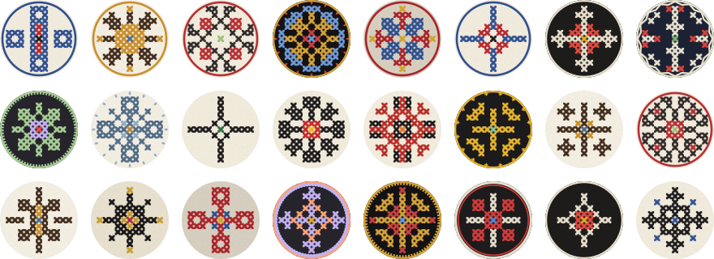

# @lbklauncher/dicebear-vyshyvanka

Vyshyvanka avatars for LBK: a [DiceBear](https://www.dicebear.com) style of Ukrainian counted-thread ornaments. Every avatar is one quarter, laid out as a cross or a star and mirrored into the other three, inside a border, in one of the regional palettes.

Try any seed at **[vyshyvanka.lbklauncher.com](https://vyshyvanka.lbklauncher.com/)**.



```ts
import { vyshyvankaDataUri, vyshyvankaSvg } from '@lbklauncher/dicebear-vyshyvanka';

const src = vyshyvankaDataUri(seed); // for 
const svg = vyshyvankaSvg(seed); // for server rendering
```

The same seed gives the same avatar everywhere: the package pins `@dicebear/core` and draws with fixed options, so the LBK launcher and site never disagree on a player's face.

## Developing

```sh
pnpm install
pnpm test          # guards, golden hashes and symmetry checks
pnpm build:style   # regenerates src/vyshyvanka.json through every guard, then docs/preview.svg
pnpm build         # dist/ for publishing
pnpm build:site    # the demo page into _site/, deployed to GitHub Pages from main
```

`src/vyshyvanka.json` is generated by `src/generator/`; never edit it by hand. A change that alters the golden hashes in `src/index.test.ts` redraws every player.
